# Application Architecture — Teacher's PET

**Stack:** Next.js 16.2.9 · React 19 · Supabase · Tailwind v4 · Vercel  
**Last updated:** 2026-07-14

---

## Diagram

```mermaid
graph TD
    %% ── CLIENT ──────────────────────────────────────────────
    Browser("🌐 Browser
    React 19 · Next.js App Router
    shadcn/ui · Base UI · Tailwind v4
    Lucide React · @supabase/ssr browser client")

    %% ── VERCEL PLATFORM ─────────────────────────────────────
    subgraph Vercel["☁️  Vercel  (deployment + CDN)"]

        subgraph Edge["⚡ Edge Middleware"]
            Proxy("proxy.ts
            — validates Supabase JWT from cookies
            — redirects unauthenticated → /login
            — public: /, /login, /register,
              /robots.txt, /sitemap.xml")
        end

        subgraph App["Next.js 16.2.9  (Node.js runtime)"]

            subgraph Public["Public routes"]
                Landing("/ — Landing page
                SEO: OG · Twitter Card · JSON-LD
                robots.txt · sitemap.xml")
                AuthPages("/login  /register")
            end

            subgraph Protected["(app) — Protected route group
            noindex — all pages require session"]
                Dashboard("/dashboard")
                Attendance("/attendance")
                LessonPlans("/lesson-plans  /lesson-plans/new  /lesson-plans/[id]")
                Learners("/learners")
                Announcements("/announcements")
                Classes("/classes  — leadership only")
                Profile("/profile")
            end

            subgraph Actions["Server Actions  'use server'"]
                SA("learners.ts · attendance.ts
                lesson-plans.ts · classes.ts
                onboarding.ts · profile.ts")
            end

            subgraph Clients["Supabase Clients"]
                SC("createServerClient
                — user-scoped session
                — RLS enforced
                — reads from cookies()")
                AC("createAdminClient
                — service_role key
                — RLS bypassed
                — onboarding & profile only")
            end
        end

        Analytics("📊 Vercel Analytics
        @vercel/analytics 2.x")
    end

    %% ── SUPABASE ─────────────────────────────────────────────
    subgraph Supabase["🔷  Supabase  (eu-central-1)"]

        SAuth("Auth
        Email / Password
        JWT sessions via cookies
        Trigger: handle_new_user()")

        subgraph DB["PostgreSQL 17"]
            Tables("13 Tables
            schools · profiles
            classes · subjects · class_teachers
            learners · attendance
            timetable_slots
            lesson_plans · announcements
            documents · assessments · assessment_results")
            RLS("Row Level Security
            — school-scoped reads/writes
            — leadership-only mutations")
            Helpers("Helper Functions
            get_my_school_id()
            get_my_role()
            is_leadership()")
        end
    end

    %% ── FLOWS ────────────────────────────────────────────────
    Browser -- "HTTPS request" --> Proxy
    Proxy -- "public route" --> Public
    Proxy -- "authenticated route" --> Protected
    Protected -- "mutations" --> SA
    SA -- "user-scoped queries" --> SC
    SA -- "privileged writes" --> AC
    Public -- "auth-aware reads" --> SC
    SC -- "@supabase/ssr" --> SAuth
    SC -- "user JWT → RLS check" --> DB
    AC -- "service_role key" --> DB
    SAuth -. "on signup: insert profile row" .-> DB
    Browser -- "page views" --> Analytics
```

---

## Layer breakdown

| Layer | Technology | Notes |
|---|---|---|
| **Client** | React 19, Next.js App Router, shadcn/ui (Base UI + Tailwind v4), Lucide React | Server Components by default; client components only where interactivity is needed |
| **Edge middleware** | `proxy.ts` on Vercel Edge | Runs before the Node.js runtime; validates the Supabase JWT from cookies on every request |
| **App server** | Next.js 16.2.9, Node.js runtime, Vercel | Server Components fetch data; Server Actions handle all mutations |
| **Auth** | Supabase Auth — email/password, JWT via `@supabase/ssr` cookies | A PostgreSQL trigger (`handle_new_user`) auto-inserts a `profiles` row on every signup |
| **Database** | Supabase PostgreSQL 17 | 13 tables, RLS enabled on every table, 3 helper SQL functions |
| **Supabase clients** | `createServerClient` (user JWT, RLS on) · `createAdminClient` (service role, RLS off) | Admin client used only for onboarding and profile writes where RLS bootstrapping is the problem |
| **Observability** | Vercel Analytics `@vercel/analytics 2.x` | Zero-config page view tracking; active on production only |

---

## Key design decisions

**Server Actions for mutations** — all writes go through `'use server'` functions. This keeps auth validation server-side, enables RLS to fire correctly, and consolidates error handling in one place. Client-side Supabase is only used for interactive re-fetches (e.g. switching classes on the attendance sheet).

**Two Supabase client patterns** — `createServerClient` is the default and enforces RLS. `createAdminClient` (service role key, never sent to the browser) is used in two places only: `onboarding.ts` (school creation requires bypassing RLS during the bootstrapping window before `school_id` exists on the profile) and `profile.ts` (same reason).

**`proxy.ts` not `middleware.ts`** — Next.js 16 renamed the middleware convention. The file exports `proxy` (not `middleware`) and uses the same `config.matcher` pattern.

**Route groups** — `(auth)` for login/register, `(app)` for the protected shell with sidebar. `/onboarding` sits outside both groups to avoid the redirect loop that would occur if it were inside `(app)` (which redirects incomplete profiles to onboarding).

**Hard navigation after auth** — `window.location.href` is used instead of `router.push()` after sign-in, sign-up, and onboarding completion to force a full page reload and bust the Next.js router cache.

---

## Package versions

| Package | Version |
|---|---|
| `next` | 16.2.9 |
| `react` | 19.2.4 |
| `@supabase/ssr` | 0.12.x |
| `@supabase/supabase-js` | 2.108.x |
| `tailwindcss` | 4.x |
| `@base-ui/react` | 1.6.x |
| `shadcn` | 4.11.x |
| `lucide-react` | 1.21.x |
| `@vercel/analytics` | 2.x |
| `typescript` | 6.x |
